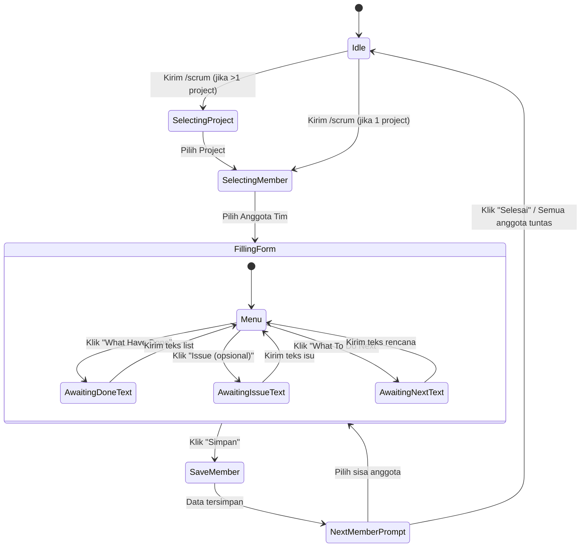

# Product Requirements Document (PRD) — Extension
# Scrum Master Tracking, Morning Brief & Weekly Reporting

**Feature Name:** Scrum Master Tracking & Standup Assistant  
**Parent Product:** ReportFlow AI (bot: Pak Carik)  
**Target Milestone:** Phase 3 Extension  
**Status:** Approved for Implementation  
**Audience:** Scrum Master / Team Lead mengelola tim pengembang per project  

---

## 1. Executive Summary & Goals

Fitur ini memperluas fungsi ReportFlow AI agar dapat digunakan secara optimal oleh seorang **Scrum Master / Team Lead** untuk:
1. **Mengelola anggota tim per project** melalui Web Dashboard.
2. **Mencatat sesi Daily Scrum** dengan cepat melalui bot Telegram (`/scrum`), baik satu per satu maupun multi-anggota secara berurutan.
3. **Menerima Morning Scrum Brief otomatis** setiap pagi di Telegram yang **hanya fokus pada Rencana Hari Ini** (diambil dari *What To Do Next*) untuk bahan obrolan standup.
4. **Menghasilkan Laporan Mingguan (Weekly Report) secara manual/on-demand** kapan saja tanpa harus menunggu jadwal otomatis.

---

## 2. User Persona & Roles

* **Primary User (Scrum Master):** Pemilik akun ReportFlow / Telegram chat yang memimpin jalannya standup dan mencatat progres pekerjaan tim.
* **Team Members (Actors / Programmers):** Anggota tim yang terikat pada project tertentu (misal: *Tiko, Budi, Andi*). Anggota ini menjadi `Assignee` dari setiap aktivitas dan task yang dicatat.

---

## 3. Data Model & Architecture

### 3.1 Relasi Project & People
* Tabel `people` diperluas dengan kolom `project_id`:
  ```sql
  ALTER TABLE people ADD COLUMN project_id BIGINT REFERENCES projects(id) ON DELETE SET NULL;
  ALTER TABLE people ADD COLUMN role_title VARCHAR(100) NULL;
  ```
* Setiap entitas `Person` terikat pada `project_id` milik user yang bersangkutan (`UserScoped`).
* Model `Project` memiliki relasi `hasMany(Person::class)`.
* Model `Person` memiliki relasi `belongsTo(Project::class)`.

### 3.2 Pemetaan Komponen Scrum ke Model ReportFlow
Ketika input scrum disimpan:
* **Assignee:** Mengaitkan `Person` ke `Task` melalui `task_people` (`role = TaskPersonRole::Assignee`).
* **What Have Done:**
  * Disimpan sebagai `Activity` dengan `activity_type` terkait (`development`, `design`, `testing`, dll).
  * Task berstatus `in_progress` atau `completed` sesuai konteks.
* **Issue (Blocker):**
  * Disimpan sebagai `Activity` dengan `activity_type = ActivityType::Blocker`.
  * Jika terdapat task yang terganggu, status task dapat diset ke `blocked` atau `waiting`.
* **What To Do Next:**
  * Disimpan sebagai task aktif (`open` atau `in_progress`) dengan `assignee = Person`.
  * Menjadi sumber utama untuk data **Rencana Hari Ini** pada Morning Scrum Brief.

---

## 4. Alur Interaksi Telegram (`/scrum`)

### 4.1 State Machine Sesi Scrum
State sesi disimpan di Redis/Cache dengan key `tg:scrum-session:{user_id}` (TTL: 1800 detik / 30 menit).



### 4.2 Langkah Detail Percakapan
1. **Pemicu:** User mengirim `/scrum`.
2. **Pemilihan Anggota:** Bot menampilkan tombol inline berisi nama-nama anggota tim pada project terkait.
3. **Menu Pengisian:**
   Bot membalas:
   ```text
   Scrum untuk Tiko (Project: Harbor Portal):
   • What Have Done: [Belum diisi]
   • Issue: [-]
   • What To Do Next: [Belum diisi]
   ```
   Tombol:
   * `[📝 What Have Done]`
   * `[⚠️ Issue (opsional)]`
   * `[🎯 What To Do Next]`
   * `[💾 Simpan]` | `[❌ Batal]`
4. **Input Data:**
   * Saat tombol ditekan, state diset ke field tersebut.
   * Pesan teks berikutnya yang dikirim user ditangkap dan disimpan ke draf session, lalu bot mengembalikan tampilan menu dengan indikator centang `✅`.
5. **Penyimpanan & Transisi Multi-Member:**
   * Saat user menekan `[💾 Simpan]`, data draf diproses ke pipeline Worklog.
   * Bot menampilkan konfirmasi sukses dan tombol untuk memilih anggota tim berikutnya yang belum dicatat dalam sesi tersebut:
     ```text
     ✅ Catatan scrum Tiko berhasil disimpan!
     Lanjut ke anggota berikutnya?
     [ 👤 Budi ]  [ 👤 Andi ]
     [ 🏁 Selesai ]
     ```
6. **Jalur Alternatif (Direct Text Paste):**
   User tetap dapat mem-paste teks multi-anggota langsung tanpa tombol:
   ```text
   Tiko
   What Have Done
   - membuat desain homepage
   Issue
   - komponen website kurang
   What To Do Next
   - menyelesaikan desain homepage
   ```
   AI membedah dan memetakan aktor serta item-itemnya secara otomatis.

---

## 5. Morning Scrum Brief (Standup Helper)

### 5.1 Jadwal & Pemicu
* Berjalan otomatis via Scheduler (`scrum:morning-brief`), default hari kerja pukul **08.30 WIB**.
* Pengaturan jam dan hari aktif mengikuti konfigurasi user di dashboard.

### 5.2 Logika Pemilihan Data & Format
* Mengambil data scrum hari kerja terakhir.
* **HANYA menampilkan Rencana Hari Ini** yang diekstrak dari *What To Do Next* tiap anggota, beserta Issue/Blocker jika ada.
* **Format Pesan Telegram:**
  ```text
  📋 Morning Scrum Brief — Project Harbor Portal
  Rabu, 29 Oktober 2026

  👤 Tiko
  • Rencana Hari Ini:
    - Menyelesaikan desain homepage
    - Membuat komponen website yang kurang
    - Membuat draft wireframe halaman about us
  • Issue: Komponen website kurang

  👤 Budi
  • Rencana Hari Ini:
    - Integrasi payment gateway
    - Testing endpoint webhook

  (Bahan pegangan obrolan Daily Standup pagi ini)
  ```

---

## 6. Laporan Mingguan Manual (On-Demand Weekly Report)

### 6.1 Karakteristik
* Tipe laporan: `ReportType::Weekly` (Senin–Minggu).
* **On-Demand:** Dapat dibuat sewaktu-waktu tanpa menunggu akhir minggu.
* Dapat di-trigger dari:
  1. **Dashboard Filament:** Form pembuatan laporan memiliki pilihan tipe "Weekly" dan rentang minggu yang diinginkan.
  2. **Telegram Bot:** Perintah `/report weekly` untuk membuat draf minggu berjalan.

### 6.2 Struktur Isi Laporan Mingguan
1. **Executive Summary:** Ringkasan pencapaian tim dalam minggu tersebut.
2. **Progres per Anggota Tim (Team Progress):** Rincian pekerjaan yang diselesaikan dan sedang berjalan dikelompokkan per programmer/assignee.
3. **Blockers & Impediments:** Isu yang terjadi sepanjang minggu dan resolusinya.
4. **Rencana Sprint / Minggu Berikutnya:** Agenda kerja berikutnya.

---

## 7. Web Dashboard: Manajemen Tim (Filament Resource)

* Menu Navigasi: **Manajemen Tim** (`/admin/team-members`).
* Kolom Form:
  * `Nama Anggota` (Wajib, string)
  * `Project` (Wajib, relasi ke `projects`)
  * `Role / Jabatan` (Opsional, string: misal *Frontend Developer*, *UI/UX Designer*)
  * `Alias / Nama Panggilan` (Opsional, tags/array untuk pencocokan AI)
  * `Catatan` (Opsional, textarea)
* Tabel Daftar:
  * Nama, Project, Role, Jumlah Task Aktif, Tanggal Dibuat.
  * Filter berdasarkan Project.

---

## 8. Tahapan Implementasi & Acceptance Criteria

| Tahap | Milestone | Acceptance Criteria |
| :--- | :--- | :--- |
| **M1** | Database & Dashboard Team Members | - Migrasi `project_id` & `role_title` pada `people`.<br>- Relasi `Project <-> Person`.<br>- Halaman Filament CRUD Manajemen Tim berfungsi penuh & user-scoped. |
| **M2** | Telegram `/scrum` Interactive Conversation | - Command `/scrum` memunculkan keyboard anggota per project.<br>- Flow tombol input (Done, Issue, Next) berjalan mulus.<br>- Multi-member sequence berfungsi tanpa keluar sesi.<br>- Direct paste parser mengenali format scrum. |
| **M3** | Morning Scrum Brief | - Scheduled command `scrum:morning-brief` berhasil merangkum Rencana Hari Ini per anggota tim.<br>- Dikirim ke Telegram pada jam yang ditentukan. |
| **M4** | Manual Weekly Report | - Opsi `ReportType::Weekly` tersedia di Dashboard.<br>- Generator menyusun laporan mingguan per anggota tim & per task ke format Markdown & PDF. |
